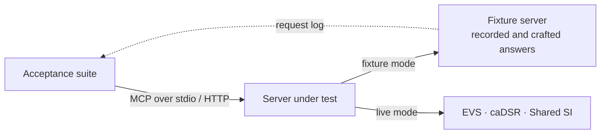

# NCI SI MCP

[](https://github.com/CBIIT/nci-si-mcp/actions/workflows/ci.yml?query=branch%3Amain)
[](https://github.com/CBIIT/nci-si-mcp/actions/workflows/github-code-scanning/codeql?query=branch%3Amain)
[](https://github.com/CBIIT/nci-si-mcp/blob/coverage-badges/provenance.json)
[](https://github.com/CBIIT/nci-si-mcp/blob/coverage-badges/provenance.json)
[](LICENSE)
[](pyproject.toml)

CI and CodeQL badges track `main`. Coverage badges show combined line and branch coverage
from successful main CI, with the measured commit and run linked; they are not acceptance pass rates.

The NCI Semantic Infrastructure Model Context Protocol (MCP) server, built to production standards
and likely to become the production codebase, though not yet declared production. It serves
terminology (NCI Thesaurus through EVS) and metadata (common data elements through caDSR), with
the cross-domain tools that join them, and it never returns content it did not retrieve:
[what the server must do](docs/specification.md#what-the-server-must-do). The repository holds four deliverables:

- **The MCP server** with its local NCIt index: [QUICKSTART.md](QUICKSTART.md).
- **The acceptance suite** that it and its successors are measured by:
  [acceptance/README.md](acceptance/README.md).
- **The documentation site**, these documents as a searchable website:
  [docs/documentation-site.md](docs/documentation-site.md).
- **The admin interface**, the validation dashboard for acceptance and benchmark runs:
  [docs/local-validation.md](docs/local-validation.md).

## Try it

**Breaking caDSR metadata change:** omitted scalar fields now stay absent instead of becoming
null; explicit null stays null. Item-owned dates and optional component identities support
[version-aware citations](QUICKSTART.md#provenance-and-truncation), with ordered API concept derivations.
Included object-class/property derivations with missing or non-Yes/No primary flags now return
`upstream_unavailable`; malformed supplied `displayOrder` is rejected instead of passed through.

```bash
pdm install                  # Python 3.14+ and PDM; see the prerequisites below
pdm run nci-si-mcp serve     # the server, over MCP stdio
pdm run acceptance           # the acceptance suite against it, on recorded upstream answers
```

[Platforms and prerequisites](QUICKSTART.md#platforms-and-prerequisites) lists what to install first.
A plain `pdm run acceptance` skips prepared, secured and optional registry-release checks.
The [complete fixture command](CONTRIBUTING.md#complete-fixture-ratchet) supplies preparation, the security
adapter and `NCI_SI_ACCEPTANCE_REGISTRY_RELEASE=required` to run all cases.

[QUICKSTART.md](QUICKSTART.md) has the rest: connecting a client, settings, tools and errors.
Protected live workflow checks need issued [workflow credentials](CONTRIBUTING.md#workflow-credentials);
fixture CI and anonymous live checks do not.

The client model holds the conversation and selects tool calls; the prompts guide it.
The tools are deterministic; the server runs no LLM.
Workflow tools also bundle their own upstream calls deterministically, with provenance.
[Domain-user stories and UAT plan](docs/user-acceptance.md) describe four proposed journeys.
UAT runs in any MCP-capable client that uses an NCI-approved model provider; none has run yet.

## How the pieces fit



The suite tests the MCP tool surface of a server it starts or connects to, against fixtures or
the live services; it knows nothing of the server's code.

[Architecture diagrams](ARCHITECTURE.md) cover system context, components, request flow,
index lifecycle and data. [Deployment diagrams](docs/deployment.md) show local stdio, local
containers and the proposed Cloud One layout.

[Behavioural test stories](docs/behavioural-tests.md) document every MCP acceptance case,
grouped by user goal, with expected answers, failure cases and links to executable evidence.

## Status

The [specification](docs/specification.md) names 29 tools in four groups.

<!-- acceptance-status:begin -->
Fixture-mode outcome of each tool, from the expected outcomes of the 1004 tests of the acceptance suite ([acceptance/expected/fixture.json](acceptance/expected/fixture.json)); [acceptance/README.md](acceptance/README.md#the-report) defines the outcomes. This table is generated by `pdm run acceptance-status`.

| Group | Tools | Outcome of each tool |
|---|---|---|
| EVS tools | 12 | PASS: `resolve_release`, `get_concept`, `get_concepts`, `search_concepts`, `get_concept_hierarchy`, `expand_value_set`, `get_concept_neighborhood`, `get_concept_subsets`, `get_concept_mappings`, `resolve_retired_code`, `list_relationships`, `list_terminologies` |
| caDSR tools | 10 | PASS: `resolve_registry_release`, `get_data_element`, `search_data_elements`, `match_data_elements`, `match_value_meanings`, `get_form`, `get_permissible_value`, `get_code_map`, `list_contexts`, `list_classification_schemes` |
| Cross-domain tools | 4 | PASS: `find_data_elements_for_concept`, `get_concept_for_permissible_value`, `resolve_stored_value`, `get_release_alignment` |
| Workflow tools | 3 | PASS: `ground_value`, `expand_cohort`, `harmonize_data_dictionary` |

Latest stored scheduled main live run: [39214306172](https://github.com/CBIIT/nci-si-mcp/actions/runs/39214306172), 2026-10-19T07:10:38Z; commit [782747778543](https://github.com/CBIIT/nci-si-mcp/commit/782747778543b0fb78498d7a3bc7e718f319475e). **Complete**.
Report SHA-256: `8a6ae3a9a2050838e9d1096f687e2cc1fe50fb4886be407e7628aadcb7254479`; artifact 12169206506.

| Tool | Live passed / failed / skipped | Skip reason / context |
|---|---|---|
| `resolve_release` | 1 / 0 / 17 | 17 unrecorded |
| `get_concept` | 6 / 0 / 41 | 41 unrecorded |
| `get_concepts` | 0 / 0 / 38 | 38 unrecorded |
| `search_concepts` | 0 / 0 / 79 | 79 unrecorded |
| `get_concept_hierarchy` | 1 / 0 / 50 | 50 unrecorded |
| `expand_value_set` | 0 / 0 / 47 | 47 unrecorded |
| `get_concept_neighborhood` | 0 / 0 / 55 | 55 unrecorded |
| `get_concept_subsets` | 0 / 0 / 32 | 32 unrecorded |
| `get_concept_mappings` | 1 / 0 / 33 | 33 unrecorded |
| `resolve_retired_code` | 0 / 0 / 34 | 34 unrecorded |
| `list_relationships` | 1 / 0 / 27 | 27 unrecorded |
| `list_terminologies` | 0 / 0 / 8 | 8 unrecorded |
| `resolve_registry_release` | 0 / 0 / 2 | 2 unrecorded |
| `get_data_element` | 8 / 0 / 35 | 35 unrecorded |
| `search_data_elements` | 2 / 0 / 23 | 23 unrecorded |
| `match_data_elements` | 3 / 0 / 21 | 21 unrecorded |
| `match_value_meanings` | 1 / 0 / 15 | 15 unrecorded |
| `get_form` | 1 / 0 / 27 | 27 unrecorded |
| `get_permissible_value` | 1 / 0 / 6 | 6 unrecorded |
| `get_code_map` | 1 / 0 / 33 | 33 unrecorded |
| `list_contexts` | 0 / 0 / 17 | 17 unrecorded |
| `list_classification_schemes` | 1 / 0 / 0 | — |
| `find_data_elements_for_concept` | 2 / 0 / 44 | 44 unrecorded |
| `get_concept_for_permissible_value` | 0 / 0 / 37 | 37 unrecorded |
| `resolve_stored_value` | 0 / 0 / 35 | 35 unrecorded |
| `get_release_alignment` | 0 / 0 / 10 | 10 unrecorded |
| `ground_value` | 0 / 0 / 48 | 48 unrecorded |
| `expand_cohort` | 0 / 0 / 46 | 46 unrecorded |
| `harmonize_data_dictionary` | 0 / 0 / 15 | 15 unrecorded |
| Unattributed gates | 16 / 0 / 45 | 45 unrecorded |
| **Total** | **46 / 0 / 920** | |

46 passed / 0 failed / 920 skipped. Skipped includes `not_live`, `not_implemented` and ordinary skips; only `not_live` has the reason contexts above. Passed validation/refusal tests do not establish live content retrieval. Unrecorded reasons are never inferred from current test markers.
<!-- acceptance-status:end -->

**Registry-release decision pending:** the CI fixture ratchet runs `required`, retaining all five
registry discovery/published-pin/cursor assertions. The harness default remains `optional`,
suspending those checks with explicit skip reasons; both modes run in the harness self-tests.
Unpinned caDSR content already works, and measured newly unblocked live tests are **none**. See the
[interim scope and sponsor proposals](docs/specification.md#interim-registry-release-selection).

[Caller permissions](docs/caller-permissions.md) and the
[required-auth HTTP entry point](docs/governed-http.md) are available; the default stays
trusted-local, and UAT/PROD administration is disabled
([docs/deployment.md](docs/deployment.md) records where it may be exposed). The
[validation and benchmark evidence](docs/benchmark.md) separates fixture acceptance, live
protocol coverage and representative live measurements; caDSR
credentialed content remains contract-fixture evidence until credentials are issued.

Cross-domain joins and `ground_value` depend on Shared SI. The team's
[8 October 2026 response](docs/upstream/team-responses-2026-10-08.md) reports maintenance
mode without funding for new API development or maintenance. The project coordinator owns
this [dependency risk and weekly query-contract register](docs/upstream/ssis-dependencies.md);
EVS SPARQL and caDSR APIs are candidate alternatives, with no alternate-upstream fallback.

The delivered phases are recorded, with their dates, in the
[implementation plan](docs/implementation-plan.md) (Phases 0 to 6), the
[Phase 6 assurance matrix](docs/phase-6-assurance.md), the
[deferred capabilities](docs/deferred-capabilities.md) and
[assisted-task evaluation](docs/assisted-evaluation.md) records, and the
[Phase 7 companion plan](docs/portal-plan.md); the
[milestones](https://github.com/CBIIT/nci-si-mcp/milestones) track what is open.

## Start here

- **The EVS, caDSR and Shared SI teams**: [docs/specification.md](docs/specification.md) specifies the
  required tools and their behaviour (rendered from `spec/`); [docs/implementation-plan.md](docs/implementation-plan.md) records
  the work, phase by phase;
  [acceptance/README.md](acceptance/README.md) runs the suite against your server and renders the
  per-tool report; the upstream requests the tools rest on, each with its operation and
  rationale, are listed for [EVS](acceptance/request-forms/evs.md), for
  [caDSR](acceptance/request-forms/cadsr.md), for the
  [Shared SI Service](acceptance/request-forms/ssis.md) and for [all](acceptance/request-forms/all.md).
  [Upstream requirements](docs/upstream/README.md) link the remaining platform requests to
  their evidence, affected tests, workarounds and acceptance criteria.
- **NCI reviewers and the suite's maintainers**: [acceptance/README.md](acceptance/README.md) and
  [acceptance/fixtures/README.md](acceptance/fixtures/README.md), where the fixtures come from.
- **Working on this repository**: [CONTRIBUTING.md](CONTRIBUTING.md) for the commands, standards
  and gates; [ARCHITECTURE.md](ARCHITECTURE.md) for how the server is built.
  Everyone taking part follows the [code of conduct](CODE_OF_CONDUCT.md).

## License

[Apache License 2.0](LICENSE). The recorded NCI Thesaurus content in the fixtures is under its own
terms, stated in [acceptance/fixtures/README.md](acceptance/fixtures/README.md).
